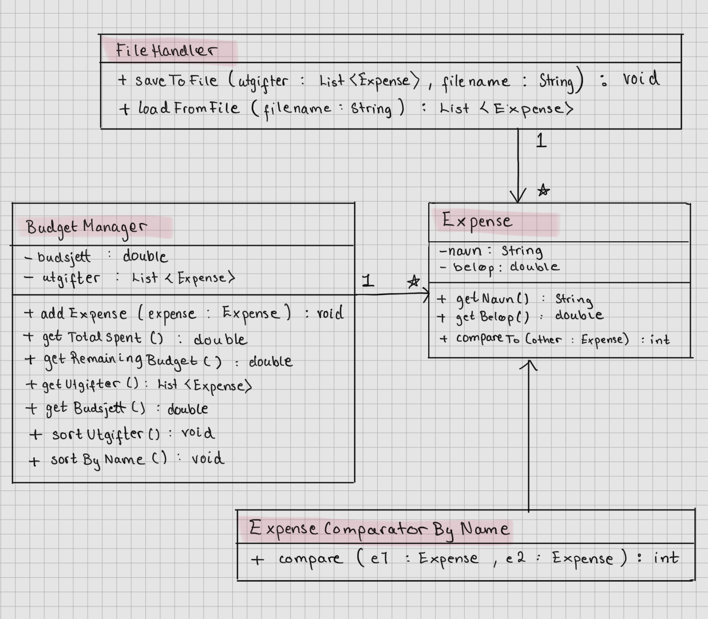

# BudgetPlanner

En enkel budsjettplanlegger med grafisk brukergrensesnitt, laget med JavaFX som et semesterprosjekt i objektorientert programmering ved NTNU.

Denne applikasjonen er en budsjettplanlegger som lar brukeren holde oversikt over økonomien sin på en enkel og oversiktlig måte. Brukeren kan sette et totalt budsjett og deretter registrere ulike utgifter med navn og beløp. Applikasjonen viser hvor mye penger som er brukt, samt hvor mye som gjenstår av budsjettet.

Brukeren kan legge til nye utgifter, og disse vises i en liste i brukergrensesnittet. Det er også mulig å sortere utgiftene enten etter pris eller alfabetisk, noe som gjør det lettere å få oversikt. I tillegg kan brukeren lagre utgiftene til en fil og laste dem inn igjen senere, slik at informasjon ikke går tapt mellom økter. 

Applikasjonen er utviklet med et grafisk brukergrensensitt ved hjelp av JavaFX, som gjør den brukervennlig og intuitiv. Målet med appen er å gi en enkel løsning for å administrere et personlig budsjett og få bedre kontroll over egne utgifter, noe jeg personlig sliter en del med. Dette er grunnen til at jeg valgte akkurat en budsjettplanlegger som prosjekt, slik at jeg eventuelt kunne bruke den selv. 


## Funksjoner

- Sett et totalt budsjett og se gjenstående beløp
- Legg til utgifter med navn og beløp
- Sorter utgifter etter pris eller alfabetisk
- Lagre utgifter til fil og last dem inn igjen senere

## Teknologi

- Java 21
- JavaFX (FXML)
- Maven
- JUnit 5

## Kjøre prosjektet

Krever Java 21 og Maven.

```bash
mvn javafx:run
```

Kjøre testene:

```bash
mvn test
```

## Struktur

Prosjektet følger Model-View-Controller:

| Del | Klasser |
|---|---|
| Modell | `Expense`, `BudgetManager` |
| View | `App.fxml` |
| Controller | `BudgetController` |
| Filhåndtering | `FileHandler` |
| Oppstart | `BudgetApp` |

`Expense` implementerer `Comparable` (sortering etter beløp), og `ExpenseComparatorByName` er en egen `Comparator` for alfabetisk sortering. `FileHandler` leser og skriver utgifter som tekst (`navn;beløp`), adskilt fra resten av logikken.



## Tester

Enhetstester dekker `BudgetManager` (legge til utgifter, totalt forbruk, gjenstående budsjett, tom liste og ugyldige verdier) og `FileHandler` (lagre og laste fra fil). GUI-et er ikke testet.

## Videre arbeid

- Støtte for inntekter, for eksempel via en felles `Transaction`-superklasse
- Flytte mer logikk fra controlleren til modellen

## Bruk av KI

KI ble brukt som støtte for å forstå konsepter som filhåndtering, testing og interfaces. Den ble ikke brukt til å generere hele løsninger. For nærmere refleksjon, se `docs/refleksjon.md`